# Lab5Web — JavaScript Dasar dan Manipulasi HTML

**Mata Kuliah:** Pemrograman Web (Pertemuan 6)
**Nama:** Rafif Mizanurohman
**NIM:** 312510377
**Kelas:** I252A

## Tujuan Praktikum

1. Memahami sintaks dasar JavaScript dan cara menyisipkan JavaScript pada HTML.
2. Menggunakan variabel, tipe data, operator, percabangan, perulangan, dan function.
3. Menampilkan informasi melalui console, alert, prompt, dan elemen HTML.
4. Memanipulasi konten serta gaya elemen HTML menggunakan JavaScript.
5. Membuat interaksi sederhana pada form dan melakukan validasi input.
6. Mendokumentasikan pekerjaan praktikum beserta hasil pengujiannya.

## Struktur Folder

```
lab5_javascript/
├── index.html   # struktur halaman dan semua elemen latihan
├── style.css    # tampilan halaman
├── script.js    # seluruh kode JavaScript
├── README.md    # laporan
└── screenshots/ # letakkan screenshot di sini
```

## Cara Menjalankan

1. Clone atau unduh repository ini.
2. Buka `index.html` di browser modern (Chrome, Firefox, Edge).
3. Buka **Inspect → Console** untuk melihat output `console.log`.
4. Klik tombol pada tiap latihan untuk mencoba programnya.

`script.js` dipanggil di akhir `<body>` dengan `<script src="script.js"></script>` supaya seluruh elemen HTML sudah tersedia saat script dijalankan.

---

## Langkah Kerja dan Hasil

> Screenshot di bawah diambil dari halaman yang dijalankan di browser (Microsoft Edge, headless) dengan interaksi nyata: klik tombol, mengisi form, serta menangani `alert`/`prompt`. Panel hitam pada beberapa screenshot adalah rekapan output Console dan dialog untuk memperlihatkan hasil pengujian.

### Latihan 1 — Menampilkan Output

Kode: `textContent` pada elemen `#pesan` diubah menjadi "Hello World", lalu `console.log("Hello World")`.

```js
document.getElementById("pesan").textContent = "Hello World";
console.log("Hello World");
```

Hasil: teks pada halaman berubah dan pesan yang sama tampil di Console.

**Perbedaan output:** pada halaman, teks tampil untuk pengguna dan mengubah isi dokumen. Di Console, teks hanya terlihat oleh developer dan tidak mengubah tampilan halaman. Panel hitam pada screenshot merekap output `console.log` tersebut.

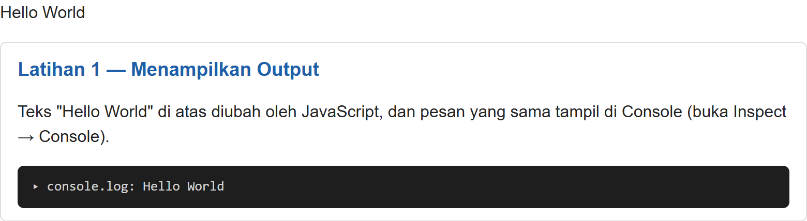

### Latihan 2 — Alert dan Prompt

Program meminta nama lewat `prompt()`, lalu menampilkan sapaan dengan `alert()` dan mengubah teks di halaman.

```js
const namaPengguna = prompt("Masukkan nama Anda:", "");

if (namaPengguna && namaPengguna.trim() !== "") {
    alert("Halo, " + namaPengguna + "!");
    document.getElementById("pesan").textContent = "Selamat datang, " + namaPengguna + ".";
} else {
    alert("Nama belum diisi.");
}
```

| Skenario | Perilaku |
|---|---|
| Memasukkan nama | Muncul alert "Halo, [nama]!" dan teks halaman menjadi "Selamat datang, [nama]." |
| Menekan Cancel | `prompt` mengembalikan `null`, kondisi `if` bernilai false, muncul alert "Nama belum diisi." |
| Input kosong lalu OK | `prompt` mengembalikan `""`, muncul alert "Nama belum diisi." |

Screenshot di bawah menunjukkan pengujian dengan input "Rafif":

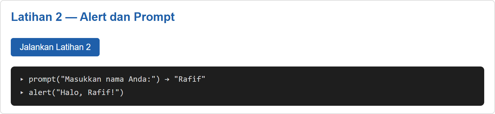

### Latihan 3 — Function dan Operasi Aritmetika

Function `operasiDasar(a, b)` menampilkan penjumlahan, pengurangan, perkalian, pembagian, dan sisa bagi, baik di Console maupun di halaman. Pembagian dan modulus dijaga agar tidak terjadi pembagian dengan nol.

```js
function operasiDasar(a, b) {
    const baris = [
        "Penjumlahan: " + (a + b),
        "Pengurangan: " + (a - b),
        "Perkalian: " + (a * b),
        "Pembagian: " + (b !== 0 ? a / b : "Tidak dapat dibagi nol"),
        "Modulus: " + (b !== 0 ? a % b : "Tidak dapat dibagi nol")
    ];

    baris.forEach((teks) => console.log(teks));
    document.getElementById("hasilLatihan3").textContent =
        "Input: a = " + a + ", b = " + b + "\n" + baris.join("\n");
}

operasiDasar(9, 4);
```

Hasil untuk `operasiDasar(9, 4)`: penjumlahan 13, pengurangan 5, perkalian 36, pembagian 2,25, modulus 1.

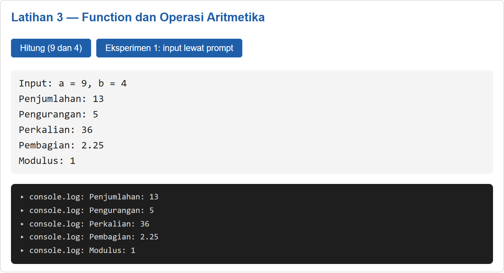

### Latihan 4 — Seleksi Kondisi if–else

Nilai diminta lewat `prompt()` lalu dikonversi dengan `Number()`. Nilai >= 60 dinyatakan lulus. Input kosong, bukan angka, Cancel, atau di luar 0–100 dianggap tidak valid.

```js
const inputNilai = prompt("Masukkan nilai (0–100):");

// Cancel menghasilkan null, jadi dicek lebih dulu sebelum memakai trim()
if (inputNilai === null) {
    alert("Input nilai tidak valid.");
    return;
}

const nilaiMahasiswa = Number(inputNilai);

if (inputNilai.trim() === "" ||
    Number.isNaN(nilaiMahasiswa) || nilaiMahasiswa < 0 || nilaiMahasiswa > 100) {
    alert("Input nilai tidak valid.");
} else if (nilaiMahasiswa >= 60) {
    alert("Lulus");
} else {
    alert("Belum lulus");
}
```

| Input | Hasil |
|---|---|
| 75 | Lulus |
| 40 | Belum lulus |
| abc | Input nilai tidak valid |
| 150 | Input nilai tidak valid |
| Cancel / kosong | Input nilai tidak valid |

Screenshot menunjukkan dua skenario berurutan: 75 → "Lulus" dan 150 → "Input nilai tidak valid.":

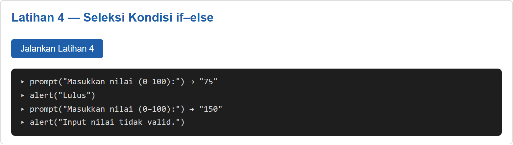

### Latihan 5 — Seleksi Kondisi switch

Angka 1–5 diubah menjadi nama bilangan memakai `switch`. Nilai selain 1–5 masuk ke `default`.

```js
const inputPilihan = prompt("Masukkan angka 1–5:");

switch (inputPilihan) {
    case "1": alert("Bilangan satu"); break;
    case "2": alert("Bilangan dua"); break;
    case "3": alert("Bilangan tiga"); break;
    case "4": alert("Bilangan empat"); break;
    case "5": alert("Bilangan lima"); break;
    default: alert("Pilihan tidak tersedia");
}
```

Screenshot menunjukkan dua skenario: input "2" → alert "Bilangan dua" dan input "9" → alert "Pilihan tidak tersedia":

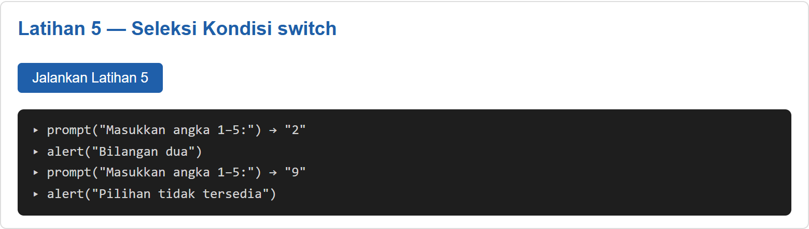

### Latihan 6 — Form Bilangan Genap atau Ganjil

```js
function cekBilangan() {
    const input = document.getElementById("bilangan").value;
    const angka = Number(input);
    const hasil = document.getElementById("hasilBilangan");

    if (input.trim() === "" || !Number.isInteger(angka)) {
        hasil.textContent = "Masukkan bilangan bulat yang valid.";
    } else if (angka % 2 === 0) {
        hasil.textContent = "Bilangan genap";
    } else {
        hasil.textContent = "Bilangan ganjil";
    }
}
```

| Input | Hasil |
|---|---|
| 8 | Bilangan genap |
| 7 | Bilangan ganjil |
| -3 | Bilangan ganjil |
| 0 | Bilangan genap |
| 2.5 | Masukkan bilangan bulat yang valid. |
| (kosong) | Masukkan bilangan bulat yang valid. |

Screenshot menunjukkan pengujian dengan input 8:

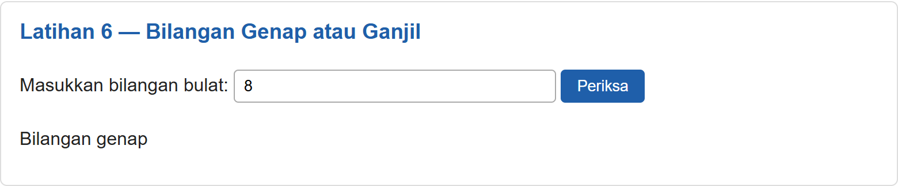

### Latihan 7 — Mengubah Warna Halaman

Satu function `ubahWarnaLatar(warna)` dipakai oleh tiga tombol (hijau, putih, kuning), sehingga kode tidak berulang.

```js
function ubahWarnaLatar(warna) {
    document.body.style.backgroundColor = warna;
}
```

Screenshot menunjukkan keadaan setelah tombol "Latar Hijau" ditekan (warna latar di sekitar section ikut berubah):

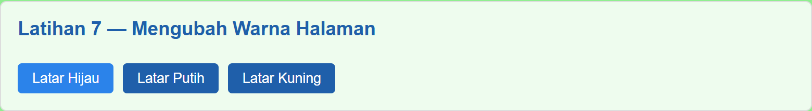

### Latihan 8 — DOM dan Checkbox Menu Makanan

Total harga dihitung ulang setiap checkbox dicentang atau dilepas menggunakan `addEventListener("change", ...)`. Sesuai Eksperimen 10, menu ditambah dua pilihan: Tahu Goreng (Rp3.000) dan Nasi Putih (Rp4.000).

```js
const daftarMenu = document.querySelectorAll(".menu");

daftarMenu.forEach((item) => {
    item.addEventListener("change", hitungTotal);
});

function hitungTotal() {
    let total = 0;

    daftarMenu.forEach((item) => {
        if (item.checked) total += Number(item.value);
    });

    document.getElementById("total").textContent = total.toLocaleString("id-ID");
}
```

Screenshot menunjukkan centang Ayam Goreng (Rp5.000) + Telur Dadar (Rp2.500) → Total Rp7.500:

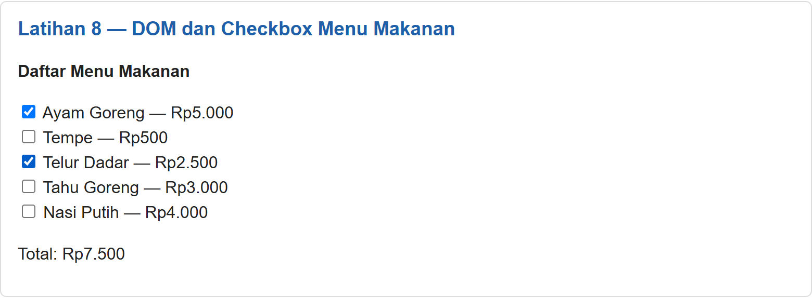

---

## Mini Project — Kalkulator Nilai Mahasiswa

Form menerima nilai Tugas, UTS, dan UAS. Rumus nilai akhir: `Tugas × 30% + UTS × 30% + UAS × 40%`.

Pemisahan fungsi:

- `hitungNilaiAkhir()` dan `tentukanPredikat()` untuk perhitungan.
- `bacaNilai()` untuk membaca dan memvalidasi input (kosong, bukan angka, atau di luar 0–100 ditolak).
- `tampilkanHasilNilai()` untuk menampilkan hasil di halaman.

Kode inti:

```js
function hitungNilaiAkhir(tugas, uts, uas) {
    return tugas * 0.30 + uts * 0.30 + uas * 0.40;
}

function tentukanPredikat(nilai) {
    if (nilai >= 85) return "A";
    if (nilai >= 75) return "B";
    if (nilai >= 60) return "C";
    if (nilai >= 50) return "D";
    return "E";
}

// Bagian tampilan dipisahkan dari bagian perhitungan
function tampilkanHasilNilai(akhir) {
    document.getElementById("outAkhir").textContent = akhir.toFixed(2);
    document.getElementById("outPredikat").textContent = tentukanPredikat(akhir);
    document.getElementById("outStatus").textContent = akhir >= 60 ? "Lulus" : "Belum lulus";
    document.getElementById("hasilNilai").hidden = false;
}

document.getElementById("formNilai").addEventListener("submit", (e) => {
    e.preventDefault();

    const tugas = bacaNilai("tugas");
    const uts = bacaNilai("uts");
    const uas = bacaNilai("uas");
    const pesanError = document.getElementById("errorNilai");

    if (tugas === null || uts === null || uas === null) {
        pesanError.textContent = "Semua nilai wajib diisi dengan angka pada rentang 0–100.";
        document.getElementById("hasilNilai").hidden = true;
        return;
    }

    pesanError.textContent = "";
    const akhir = hitungNilaiAkhir(tugas, uts, uas);
    console.log("Nilai akhir:", akhir.toFixed(2));
    console.log("Predikat:", tentukanPredikat(akhir));
    console.log("Status:", akhir >= 60 ? "Lulus" : "Belum lulus");
    tampilkanHasilNilai(akhir);
});
```

Predikat: A (>= 85), B (>= 75), C (>= 60), D (>= 50), E (< 50). Status lulus jika nilai akhir >= 60.

| Skenario | Tugas | UTS | UAS | Nilai Akhir | Predikat | Status |
|---|---|---|---|---|---|---|
| 1 | 85 | 78 | 88 | 84,10 | B | Lulus |
| 2 | 90 | 95 | 92 | 92,30 | A | Lulus |
| 3 | 40 | 50 | 45 | 45,00 | E | Belum lulus |
| 4 | 120 | 80 | 80 | — | — | Ditolak (di luar 0–100) |

Screenshot skenario 1 (85/78/88 → 84.10, predikat B, Lulus), tampil di halaman sekaligus di Console:

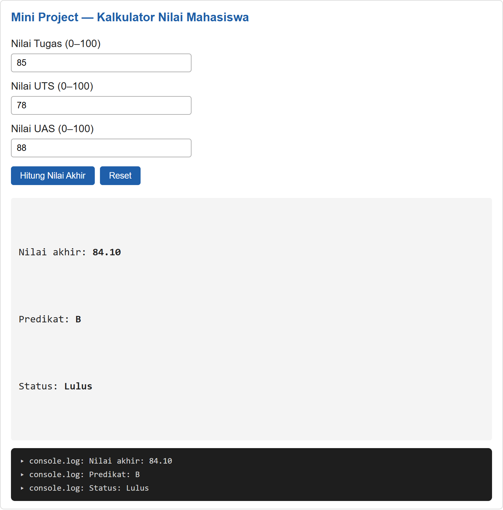

---

## Eksperimen Mandiri

| No | Eksperimen | Keterangan |
|---|---|---|
| 1 | Latihan 3 dengan input `prompt` | Tombol "Eksperimen 1"; input dikonversi dengan `Number()` dan divalidasi |
| 7 | Tabel perkalian 7 | Perulangan `for` dari 1 sampai 10 |
| 8 | Function `cekGenap(angka)` | Mengembalikan `true` jika genap, `false` jika ganjil |
| 9 | Validasi kolom tidak boleh kosong | Digabung dengan form Tugas No. 7 |
| 10 | Menambah menu pada Latihan 8 | Ditambah Tahu Goreng dan Nasi Putih |
| 11 | Sembunyikan/tampilkan elemen | Mengubah `style.display` antara `none` dan `block` |

Kode Eksperimen 7, 8, dan 11:

```js
// Eksperimen 7: tabel perkalian
function tabelPerkalian(angka) {
    let teks = "";
    for (let i = 1; i <= 10; i++) {
        teks += angka + " x " + i + " = " + (angka * i) + "\n";
    }
    document.getElementById("hasilTabel").textContent = teks.trim();
}

// Eksperimen 8: cekGenap
function cekGenap(angka) {
    return angka % 2 === 0;
}

// Eksperimen 11: sembunyikan / tampilkan elemen
document.getElementById("tombolToggle").addEventListener("click", () => {
    const elemen = document.getElementById("elemenToggle");
    elemen.style.display = elemen.style.display === "none" ? "block" : "none";
});
```

**Eksperimen 7** — Tabel perkalian 7 ditampilkan lewat perulangan `for`:

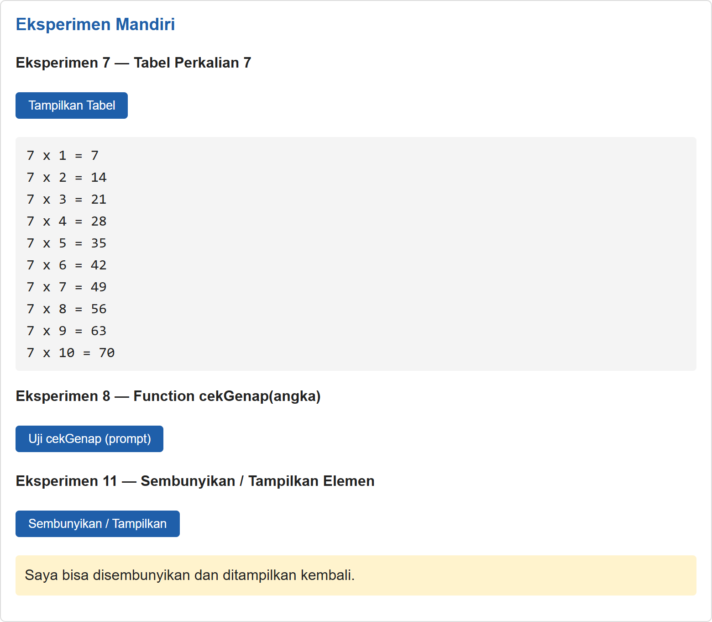

**Eksperimen 8** — `cekGenap(4)` mengembalikan `true` (input 4 lewat `prompt`):

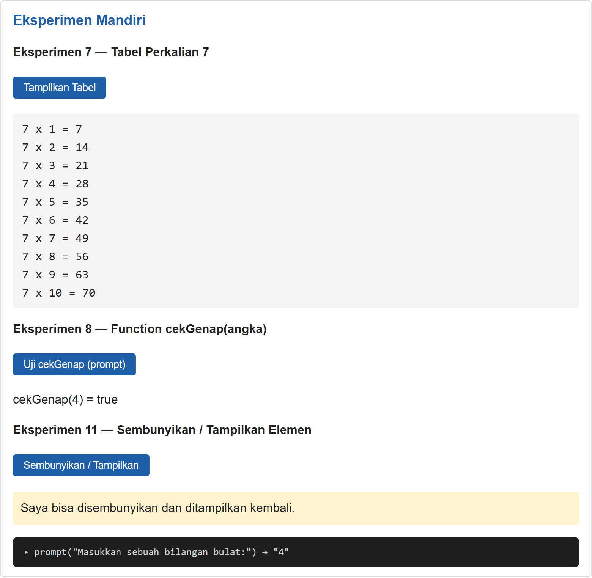

**Eksperimen 11** — Elemen disembunyikan lalu ditampilkan kembali dengan satu tombol:

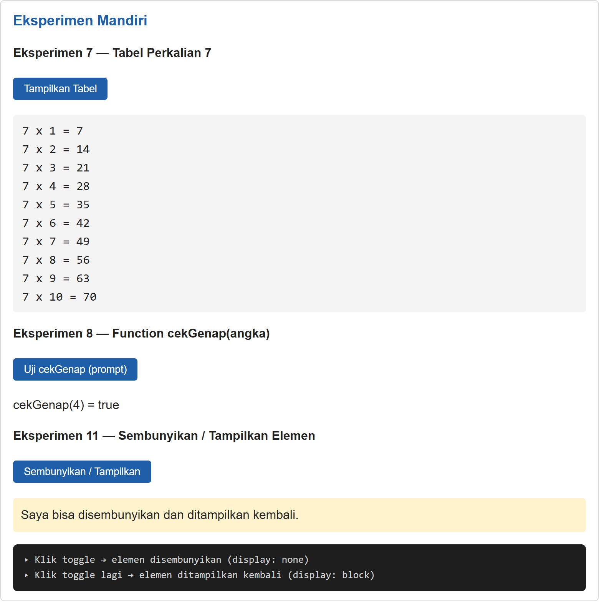

**Gabungan** — seluruh section Eksperimen Mandiri dalam satu tampilan:


---

## Jawaban Pertanyaan dan Tugas

### 1. Perbedaan `console.log()`, `alert()`, `prompt()`, dan `textContent`/`innerHTML`

- `console.log()` menulis pesan ke Console browser. Dipakai untuk debugging dan tidak terlihat oleh pengguna biasa.
- `alert()` menampilkan kotak dialog berisi pesan dan menghentikan interaksi sampai pengguna menekan OK.
- `prompt()` menampilkan dialog dengan kolom isian. Hasilnya selalu string, atau `null` jika dibatalkan.
- `textContent` mengubah isi teks elemen HTML sebagai teks biasa. `innerHTML` mengubah isi elemen dan menafsirkan string sebagai markup HTML, sehingga lebih berisiko jika memuat input pengguna (rawan XSS). Untuk teks biasa lebih aman memakai `textContent`.

### 2. Perbedaan `let` dan `const`

`let` untuk variabel yang nilainya boleh ditetapkan ulang, sedangkan `const` untuk variabel yang tidak boleh ditetapkan ulang.

```js
let umur = 20;
umur = 21;          // boleh

const nama = "Rani";
// nama = "Dina";   // error: Assignment to constant variable
```

### 3. Perbedaan `==` dan `===`

`==` membandingkan nilai setelah konversi tipe otomatis, sedangkan `===` membandingkan nilai sekaligus tipenya tanpa konversi. Sebaiknya memakai `===` agar hasil lebih dapat diprediksi.

```js
5 == "5";    // true
5 === "5";   // false
0 == false;  // true
0 === false; // false
```

### 4. Fungsi `if–else` dan `switch`

- `if–else` menguji kondisi logis, termasuk rentang dan kombinasi kondisi. Cocok untuk kondisi seperti `nilai >= 60`.
- `switch` memilih satu tindakan dari sejumlah nilai tertentu. Cocok untuk membandingkan satu variabel dengan banyak nilai pasti, seperti menu pilihan 1–5. `break` mencegah eksekusi berlanjut ke `case` berikutnya.

### 5. Fungsi parameter dan `return`

Parameter adalah variabel penerima data masukan saat function dipanggil, sehingga function bisa dipakai ulang dengan data berbeda. `return` mengembalikan hasil ke pemanggil dan mengakhiri function.

```js
function hitungLuas(panjang, lebar) {
    return panjang * lebar;
}
console.log(hitungLuas(8, 4)); // 32
```

### 6. Memilih elemen dengan `document.getElementById()`

Method ini mencari elemen berdasarkan atribut `id` dan mengembalikan objek elemen tersebut (atau `null` jika tidak ada). Objek itu lalu bisa diubah isi dan gayanya.

```js
const el = document.getElementById("pesan");
el.textContent = "Halo, JavaScript!";
el.style.color = "blue";
```

### 7. Validasi form (nama tidak kosong, nilai 0–100)

Kode ada di bagian akhir `script.js` (form `#formValidasi`). Logika intinya:

```js
document.getElementById("formValidasi").addEventListener("submit", (e) => {
    e.preventDefault();

    const nama = document.getElementById("nama").value.trim();
    const nilaiTeks = document.getElementById("nilai").value.trim();
    const nilai = Number(nilaiTeks);
    const pesan = document.getElementById("pesanValidasi");

    pesan.className = "error";

    if (nama === "") {
        pesan.textContent = "Nama tidak boleh kosong.";
    } else if (nilaiTeks === "") {
        pesan.textContent = "Nilai tidak boleh kosong.";
    } else if (Number.isNaN(nilai) || nilai < 0 || nilai > 100) {
        pesan.textContent = "Nilai harus berupa angka pada rentang 0–100.";
    } else {
        pesan.className = "sukses";
        pesan.textContent = "Data valid. Nama: " + nama + ", Nilai: " + nilai + ".";
    }
});
```

Pengujian gagal — form dikirim dalam keadaan kosong:

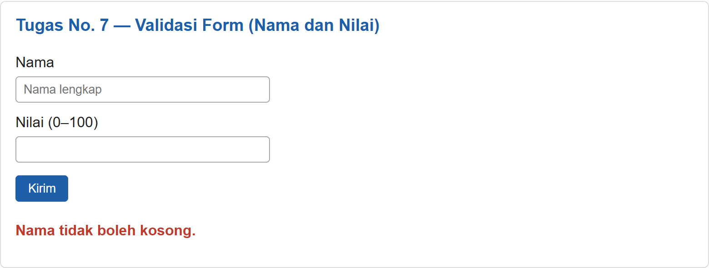

Pengujian berhasil — nama "Rafif Mizanurohman" dan nilai 90:

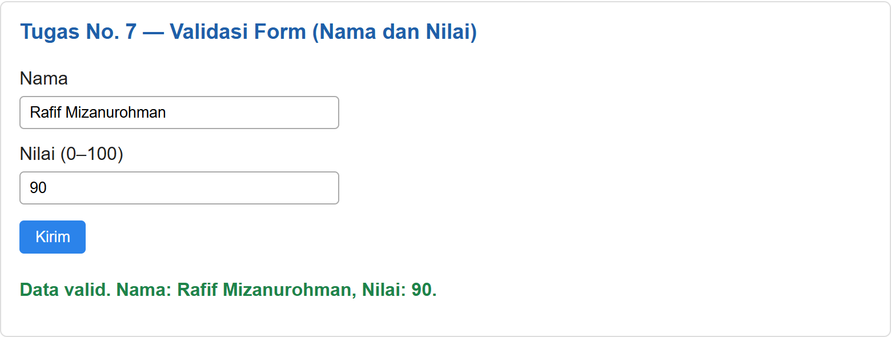

---

## Kesimpulan

Dari praktikum ini saya mempelajari cara menyisipkan JavaScript eksternal, memakai variabel, operator, percabangan, perulangan, dan function, serta memanipulasi elemen HTML melalui DOM. Saya juga belajar bahwa input pengguna harus divalidasi, misalnya karena `prompt()` selalu menghasilkan string dan bisa bernilai `null`.
